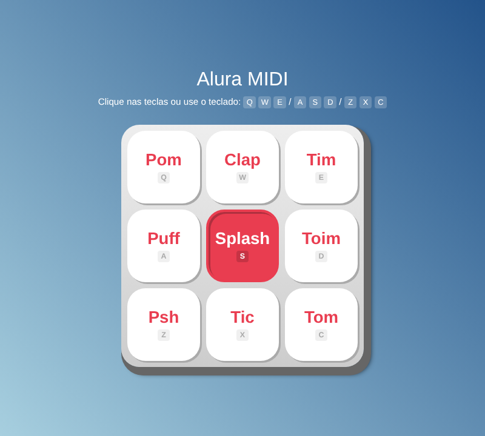

# Alura MIDI

[](https://github.com/almircs/Aluramidi/actions/workflows/ci.yml)

Bateria virtual com 9 sons, tocada com o mouse, com o toque no celular ou com o teclado do computador. Projeto do curso de lógica de programação com JavaScript da Alura.

**[▶ Tocar agora](https://almircs.github.io/Aluramidi/)**



## Como tocar

| | | |
|:-:|:-:|:-:|
| `Q` Pom | `W` Clap | `E` Tim |
| `A` Puff | `S` Splash | `D` Toim |
| `Z` Psh | `X` Tic | `C` Tom |

Também dá para navegar com `Tab` e tocar com `Espaço` ou `Enter`.

## O que pratiquei

- Seleção de elementos com `querySelector` e `querySelectorAll`
- Laços de repetição e template strings
- Eventos de clique e de teclado (`keydown` e `keyup`)
- Reprodução de áudio com o elemento `<audio>`
- CSS Grid e variáveis CSS

## Rodar localmente

```bash
git clone https://github.com/almircs/Aluramidi.git
```

Depois é só abrir o `index.html` no navegador.

## Licença

[MIT](LICENSE)
